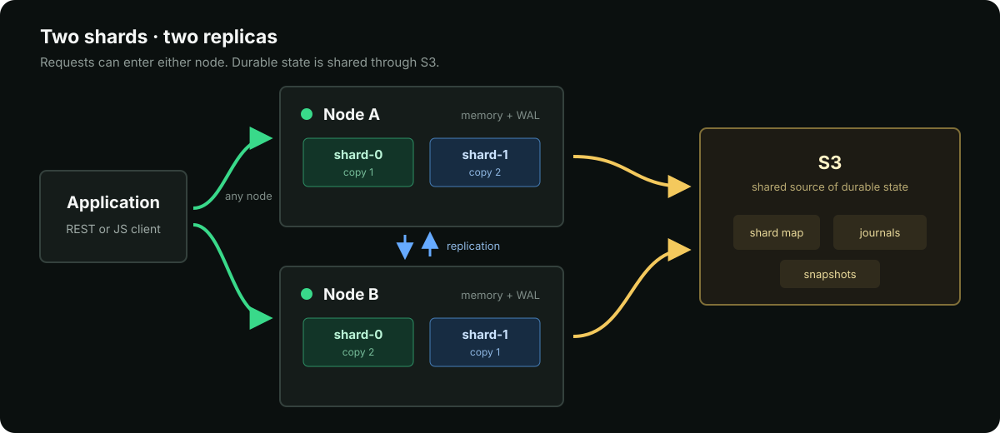

# OBJY DB

Run OBJY DB, work with dynamic objects, and operate one node or a cluster.

`@objy/db` includes the engine, HTTP API, authentication, persistence, clustering, and Data Explorer. Applications connect through [`@objy/client`](https://github.com/objy-org/objy-client) or [REST](API.md); the client does not start a database.

[Run](#run-the-server) · [Configure](#configuration) · [Objects](#object-model) · [Queries](#queries-and-aggregation) · [Meta](#collection-meta) · [Persistence](#persistence-and-recovery) · [Clusters](#shards-and-replicas) · [Operations](#operating-the-database)

## Run the Server

### Single Node

Install the database with Node.js 20 or newer:

```sh
npm install --global @objy/db
```

Without a config file, start a memory-only node with authentication and the UI:

```sh
objy --node node-a --port 8080
```

`--node` is required when no config supplies it; the port defaults to 8080. Object data is not persisted. An existing `./objydb.config.json` is still loaded automatically.

To keep settings in a file, create `objydb.config.json`:

```json
{
  "node": { "id": "node-a", "url": "http://127.0.0.1:8080" },
  "server": { "port": 8080 }
}
```

```sh
objy
objy --config /path/to/objydb.config.json
```

`objy` loads the config, establishes credentials, restores durable data when configured, and starts replication, the API, and Data Explorer. Open the printed URL and sign in with the administrator password from the logs. Ctrl+C or SIGTERM shuts the foreground process down gracefully.

| Option | Purpose |
| --- | --- |
| `--config <file>` | Config path; defaults to `./objydb.config.json`. |
| `--node <id>`, `--url <url>`, `--port <port>` | Per-node overrides for a shared config. |
| `--help`, `--version` | Usage or installed version. |

For project-local use: `npm install @objy/db`, then `npm exec -- objy --config objydb.config.json`. Direct startup also works: `node node_modules/@objy/db/src/index.js`. The executable does not provision infrastructure or manage background processes. See [Contributing](CONTRIBUTING.md) for source setup.

### Cluster Setup

Use the [S3-backed configuration below](#configuration) on every node. One shared shard map assigns objects across all databases and collections. This example has **two shards, two copies per shard, and four node processes**.

Save `shard-map.json`:

```json
{
  "shards": {
    "shard-a": {
      "peers": [
        { "nodeId": "a1", "url": "http://127.0.0.1:8080" },
        { "nodeId": "a2", "url": "http://127.0.0.1:8081" }
      ]
    },
    "shard-b": {
      "peers": [
        { "nodeId": "b1", "url": "http://127.0.0.1:8082" },
        { "nodeId": "b2", "url": "http://127.0.0.1:8083" }
      ]
    }
  }
}
```

Publish it before starting the cluster. This helper requires a [source checkout](CONTRIBUTING.md#development); it is not part of the npm package:

```sh
node scripts/put-shard-map.js --config objydb.config.json --map shard-map.json
```

Start `a1` first to establish shared bootstrap state, then run each remaining node in its own terminal or process manager:

```sh
objy --config objydb.config.json --node a1 --url http://127.0.0.1:8080 --port 8080
objy --config objydb.config.json --node a2 --url http://127.0.0.1:8081 --port 8081
objy --config objydb.config.json --node b1 --url http://127.0.0.1:8082 --port 8082
objy --config objydb.config.json --node b2 --url http://127.0.0.1:8083 --port 8083
```

All nodes share S3 settings and system secrets; each needs a unique identity, reachable URL, and separate local WAL state. The configured WAL root separates nodes by ID. Replace loopback URLs with peer-reachable addresses on separate machines. Clients can connect to any node; requests route to the appropriate shard.

The S3 map overrides `cluster.shardMap`. An inline map with shard-map storage off supports temporary memory-only clusters, but durable resharding and safe clustered database/collection deletion require shared persistence. The first peer in each shard is its fixed primary; there is no automatic election. See [Shards and Replicas](#shards-and-replicas) before changing topology.

### From a Node.js Application

Use an ES module such as `server.mjs`:

```sh
npm install @objy/db
```

```js
import { startServer } from "@objy/db";

const runtime = await startServer({ port: 8080 });
console.log(`OBJY DB listening on http://127.0.0.1:${runtime.port}`);
```

**Memory-only HTTP server:** `startServer()` takes runtime options, not the JSON config, and performs no S3/WAL recovery. Generated credentials and data are not durable; the application owns shutdown. Use `objy` for full configured startup.

## Configuration

Durable S3 example, not defaults. Create the bucket first; use a distinct prefix for each independent cluster.

```json
{
  "node": {
    "id": "node-a",
    "url": "http://127.0.0.1:8080",
    "retainOps": 256,
    "syncBatchSize": 50000
  },
  "server": { "port": 8080, "cors": false },
  "storage": { "engine": "object" },
  "files": { "mode": "s3", "prefix": "objydb/files" },
  "memoryGuard": {
    "enabled": true,
    "limitMb": 4096,
    "rejectWritesPercent": 85,
    "resumeWritesPercent": 78
  },
  "cluster": {
    "syncMs": 2500,
    "forwardTimeoutMs": 60000,
    "replicationTimeoutMs": 60000,
    "shardMapStore": {
      "mode": "s3",
      "prefix": "objydb",
      "key": "cluster/shard-map.json"
    }
  },
  "auth": {
    "accessTokenTtlSeconds": 3600,
    "refreshTokenTtlSeconds": 1209600
  },
  "persistence": {
    "mode": "s3",
    "prefix": "objydb",
    "ack": "localWal",
    "flushMs": 5000,
    "snapshotMs": 60000,
    "compactJournals": true,
    "snapshotRetention": { "keepLatest": 5 },
    "localWal": { "mode": "on", "dir": ".objydb/wal", "fsync": true },
    "s3": {
      "bucket": "objydb",
      "endpoint": "https://s3.example.com",
      "region": "us-east-1",
      "accessKeyId": { "fromEnvironment": "OBJYDB_S3_ACCESS_KEY_ID" },
      "secretAccessKey": { "fromEnvironment": "OBJYDB_S3_SECRET_ACCESS_KEY" }
    }
  }
}
```

| Section | What it controls |
| --- | --- |
| `node` | Unique `id`, reachable `url`, recent-log bound `retainOps` (default 256), and pull limit `syncBatchSize` (default 1024). |
| `server` | HTTP `port` (default 8080), `cors`, and JSON request limits. |
| `storage` | Object engine and automatic, bounded value dictionaries. `object` is the default and only built-in engine. |
| `files` | Private blobs; `off` by default. `s3` inherits `persistence.s3`, with optional `files.s3` overrides. |
| `memoryGuard` | RSS-based write admission; disabled by default. Uses per-process `limitMb` or detected container/host memory. |
| `cluster` | Replication hints, `syncMs` (default 2500), forwarding/replication timeouts (both 60000), and shard-map storage. |
| `auth` | JWT lifetimes and initial-user options. Enabled by default; missing secrets are generated. |
| `persistence` | S3 connection, namespace, acknowledgement, journals, snapshots, and retention. Defaults: `mode: "off"`, `ack: "memory"`. |
| `imports` | Bounded write admission: `maxBulkObjects`, `maxBulkBytes`, `maxObjectBytes`, `maxPendingPersistenceBytes`, `persistenceWaitMs`, and `retryAfterMs`. |
| `plugins`, `vector` | Code-registered extensions and vector-index settings. |

Use literal strings or `fromEnvironment` references; missing referenced variables fail startup. Keep credentials out of Git and restrict config access.

For a separate browser application, allow its origin explicitly:

```json
{ "server": { "port": 8080, "cors": { "origins": ["https://app.example.com"] } } }
```

Generated secrets live in shared S3 when available, locally otherwise. Preserve them and each node's WAL state.

Write admission pauses batches before mutation when journal/WAL backlogs grow, including routed writes and replication. Waits use flush notifications, not polling. `imports.maxPendingPersistenceBytes` defaults to 256 MiB of queued/in-flight bytes: a pressure threshold, not a hard memory cap. Admitted batches may exceed it; waiting capacity is bounded.

`imports.persistenceWaitMs` allows 60000 ms per pressured batch (`0` rejects immediately), without resetting on progress. Failure, cancellation, full waiting capacity, or deadline ends the wait; pressure errors use `503` and `Retry-After`. Client/forwarding timeouts can expire sooner. Allow time for long imports; acknowledgement still follows `persistence.ack`.

## Object Model

```text
database
  collection + meta
    objects
```

A **database** is a namespace; a **collection** holds objects and one metadata document. **Objects** are dynamic JSON with an `_id`. Shapes and value types may differ within a collection; adding fields needs no migration.

### Object Anatomy

```json
{
  "_id": "asset-1",
  "name": "Laptop",
  "type": "asset",
  "status": "active",
  "kind": "device",
  "score": 42,
  "tags": ["inventory"],
  "owner": { "type": "reference", "collection": "users", "value": "user-1" },
  "_vec": [0.2, 0.8, 0.4]
}
```

- `_id`: unique per collection; omitted IDs become random, 16-character URL-safe strings. Use `createdAt`, not IDs, for chronological order.
- References: live links expanded as `.object`, also usable in query paths.
- `_vec`: supplied embedding, stored separately and hidden from ordinary reads.
- `_file`: server-managed link to private S3 file content.

Reads return full JSON, transparently hydrating columns and compressed fields. Expanded references and structure defaults are read views, not persisted copies.

## Working with Objects

Install `@objy/client`; these examples share one fresh database:

```js
import { createClient } from "@objy/client";

const client = createClient({ url: "http://127.0.0.1:8080" });
await client.login({ username: "admin", password: "<printed-password>" });

await client.createDatabase("app");
const app = client.database("app");
await app.createCollection("users", { indexes: ["username"] });
await app.createCollection("assets", { indexes: ["status", "kind"], columns: ["score"] });
const users = app.collection("users");
const assets = app.collection("assets");
```

### Single and Bulk Operations

```js
await assets.insert({ _id: "asset-1", name: "Laptop", status: "new" });
await assets.get("asset-1");
await assets.replace("asset-1", {
  name: "Laptop Pro", type: "asset", kind: "device", status: "active", score: 75
});
await assets.patch("asset-1", { $set: { score: 80 }, $unset: ["legacyFlag"] });

await assets.insertMany([
  { _id: "asset-2", type: "asset", kind: "device", status: "active", score: 20 },
  { _id: "asset-3", type: "asset", kind: "vehicle", status: "archived", score: 40 }
], { minimal: true });
await assets.replaceMany([{ _id: "asset-2", type: "asset", kind: "device", score: 25 }]);
await assets.patchMany([{ _id: "asset-3", $set: { score: 50 } }]);
```

| Operation | Behavior |
| --- | --- |
| `insert` / `insertMany` | Create; duplicate IDs conflict, including within a batch. |
| `replace` / `replaceMany` | Full-object upsert; omitted fields disappear. |
| `patch` / `patchMany` | Change only `$set` / `$unset` paths, including nested paths. |

Single writes share bulk storage and replication. Normal responses contain objects; `{ minimal: true }` returns counts without readback or generated IDs. Supply IDs to track imports.

Delete with `await assets.remove("asset-1")` or `await assets.removeMany(["asset-2", "asset-3"])`. Collection deletion includes objects and meta; database deletion includes its collections. No multi-object ACID transactions or cross-request read snapshots are provided.

### Streamed Imports

NDJSON streams become bounded bulk batches inside the database:

```js
async function* source() {
  for (let n = 0; n < 100000; n++) {
    yield { _id: `import-${n}`, type: "asset", kind: "device", score: n };
  }
}

await assets.import(source, { operation: "insert" });
await assets.import([
  { _id: "import-2", $set: { score: 99 } }
], { operation: "patch" });
```

`import` also accepts `replace` (full objects) and `remove` (IDs); patches contain `_id` and update operators. Streaming avoids giant JSON arrays, not validation, indexing, WAL, or replication work.

**Earlier batches remain committed if a stream fails.** Use stable IDs and inspect committed counts before retrying. A source factory lets the client recreate the stream for safe authentication renewal. See [wire formats and limits](API.md#streamed-bulk-writes) and the [client guide](https://github.com/objy-org/objy-client).

## Queries and Aggregation

```js
await assets.find({ status: "active" }, { limit: 50, sortBy: "_id" });

await assets.search({
  score: { $gte: 20 },
  $sort: { score: -1 },
  $page: 1,
  $pageSize: 50
});

await assets.count({ kind: "device" });

await assets.search({
  $aggregate: {
    groupBy: "kind",
    fields: {
      totalScore: { $sum: "score" },
      averageScore: { $avg: "score" },
      count: { $count: true }
    },
    $sort: { totalScore: -1 }
  }
});
```

Queries support comparisons, array membership (`$contains`), logic, nested paths, sorting, and paging. `search` handles ordinary and vector queries. Aggregation supports grouping, `$sum`, `$avg`, `$min`, `$max`, and `$count`; sum/average inputs must be finite numbers, not numeric strings. See [all operators and responses](API.md).

The planner combines indexes, columns, and scans. Indexed grouping over a column can avoid full-object hydration, not all per-value work. `x-objydb-query-path` reports paths such as `index-full`, `scan`, or `aggregate-*`; sharded responses may list several.

### Sorting and Paging

Default order is `_id` ascending, also the tie-breaker for explicit sorts across shards. Ordering is deterministic, not chronological or snapshot-isolated.

Pages use offsets, capped at 250 objects. Writes, deletes, changed sort values, and replica lag can shift page boundaries. Deep offsets and unindexed sorts cost more.

```js
for await (const asset of assets.iterate({ kind: "device" }, { pageSize: 100 })) {
  console.log(asset._id);
}
```

The iterator walks ordinary pages, not a stable cursor or aggregate/vector results.

## Collection Meta

Collection meta holds database settings and custom application data. It stays in memory and persists separately in S3 when enabled:

```js
await assets.setMeta({
  indexes: ["status", "kind"],
  columns: ["score"],
  tiering: {
    mode: "compressedMemory",
    keep: ["name", "type", "status", "kind"],
    minBytes: 4096
  },
  structure: [
    { condition: { type: "asset" }, apply: { lifecycle: { managed: true } } }
  ]
});

const meta = await assets.getMeta();
```

`setMeta` replaces the document; read and merge first to preserve other settings.

### Field Indexes

`indexes: ["status", "owner.value"]` maps values to internal object IDs for equality, array membership, grouping, and supported sorts. Nested paths work; `_id` already has direct lookup.

Index fields your queries use: each index costs memory and write maintenance. Broad matches still require work, though low-selectivity indexes can help grouping.

### Columns

`columns: ["score"]` moves values into collection-scoped storage addressed by internal IDs (RIDs): typed storage for numbers/booleans, dictionaries for strings, and overflow for mixed types. Objects stay dynamic.

Values leave the object body, avoiding duplication. Reads restore the same JSON; aggregates and field-only reads skip unrelated fields. Removing a column moves values back into objects.

Columns store values compactly; field indexes find objects. Neither changes the full-object S3 format.

### Compressed Memory

```json
{
  "tiering": {
    "mode": "compressedMemory",
    "offload": ["history", "rawPayload"],
    "minBytes": 4096
  }
}
```

Choose `keep` for hot fields or `offload` for compressible fields, never both. Payloads below `minBytes` stay uncompressed. Compression uses in-memory DEFLATE, not disk. Indexed/column fields stay hot automatically; arrays retain their shape.

Reads hydrate selected results without a `_warm` marker. Scanning compressed, unindexed fields still requires decompression. Use this CPU/memory tradeoff for large, repetitive payloads that are rarely scanned; small pages limit hydration where the query path allows.

Changes retier existing objects cooperatively; `mode: "off"` restores ordinary fields. Statistics compare tiered payload bytes, not total heap or RSS.

Bounded value dictionaries separately intern eligible repeated values, controlled by `storage.object.valueDirectory` rather than collection meta.

### Conditional Structure

```json
{
  "structure": [
    { "condition": {}, "apply": { "source": "inventory" } },
    { "condition": { "type": "asset" }, "apply": { "status": "managed" } }
  ]
}
```

Structure supplies read defaults without storing them per object. Conditions inspect physical fields; later matches override earlier defaults, but explicit object values win. Unsetting an override reveals its fallback. Identity, auth, file, and vector fields cannot be virtual.

**Virtual fields are not queryable:** filters, sorts, paging membership, aggregation, indexes, and columns use physical fields. Defaults never enter WAL, replication, journals, or snapshots. Structure changes affect the next read without rewriting data or rebuilding indexes.

### When Meta Changes

Index builds, column migration, and compression use bounded cooperative jobs in the main process, not isolated workers. A meta response accepts settings, not completed work. Reads/writes remain correct through potentially slower fallbacks; the config view reports readiness.

## Live References

```js
await users.insert({ _id: "user-1", username: "alice" });
await assets.insert({
  _id: "owned-asset",
  name: "Shared laptop",
  owner: { type: "reference", collection: "users", value: "user-1" }
});

await assets.get("owned-asset"); // owner.object contains the current referenced object
await assets.get("owned-asset", { refDepth: 0 }); // descriptor only
await assets.search({ "owner.object.username": "alice", $refDepth: 0 });
```

References resolve on reads, including across shards, with permissions enforced. Default database is the current one; add `database` to cross it. Expansion depth defaults to one; `$refDepth: 0` hides expanded output but still evaluates reference predicates.

Vector search cannot be combined with reference-`.object` predicates. See [Live References](API.md#live-references) for the complete descriptor and depth behavior.

## Vector Search

Clients supply embeddings, so no embedding provider is required:

```js
await assets.insert({ _id: "vector-asset", name: "Laptop", _vec: [0.2, 0.8, 0.4] });
```

Once its vector index is ready, search it:

```js
const matches = await assets.search({ $vector: { vector: [0.21, 0.79, 0.4], limit: 10, ef: 64 } });
```

HNSW search uses cosine similarity, ordinary filters, and permissions. Supply finite, dimension-compatible vectors from the same embedding model. Vectors are durable; the derived HNSW index is not persisted.

Configure `vector.enabled`, `vector.field` (default `_vec`), and `vector.hnsw` (`M`, `efConstruction`, `efSearch`). Boot, rebuilds, or vector writes can cause `503` / `"vector index warming"`. Retry search after warmup, not the insert; ordinary reads remain available.

## Files

Enable `files.mode: "s3"`. Each object can wrap one private blob:

```js
await assets.insertFile(
  { _id: "manual", title: "Notes" },
  new Blob(["Hello"], { type: "text/plain" }),
  { filename: "notes.txt" }
);
await assets.replaceFile(
  "manual",
  { title: "Updated notes" },
  new Blob(["Updated"], { type: "text/plain" }),
  { filename: "notes.txt" }
);
const response = await assets.download("manual");
const content = await response.blob();
await assets.remove("manual");
```

The server manages `_file: { storage, key, mimeType }`. Object permissions govern blob reads; clients need no S3 credentials. CRUD controls object and file together. Uploads are single-object multipart, not bulk/NDJSON.

Replacement stages a blob, commits its pointer, then removes the old blob best-effort. Leftovers are not version history; snapshots store descriptors, not independent file copies. See [File Handling](API.md#file-handling).

## Authentication and Permissions

Startup creates the missing administrator in `_global/users` and prints its generated password once. Set `OBJYDB_ADMIN_PASSWORD` before first boot to choose it; this never resets an existing user. Protect logs and bootstrap state.

Any collection can hold users with `username` and `password`; hashes are excluded from public reads. Login at `/api/{database}/{collection}/auth`, renew at `/api/{database}/{collection}/renew`. Tokens default to one hour (access) and 14 days (refresh). Global admins log in at `_global/users`.

Passwords accept plaintext, up to 1024 UTF-8 bytes. Node's asynchronous PBKDF2-HMAC-SHA256 uses 600,000 iterations, a 16-byte random salt, and a 32-byte hash, without an external package. Two active and 32 waiting jobs bound work per process; overload returns `503` / `Retry-After`. Successful login durably upgrades weaker hashes; restore and replication preserve hashes unchanged.

**Access tokens remain valid until expiry**, including after permission changes or account deletion. Renewal reloads the account/permissions and checks `tokenVersion`; requests do not perform account lookups for immediate revocation.

A database can be created with its own administrator:

```js
await client.createDatabase("team", {
  adminUser: { username: "owner", password: "<chosen-password>" }
});
```

This creates `users` and an `admin: true` account. Database admins manage their database; global admins can manage others. `_global` is publicly read-only for everyone, including meta and context changes.

Non-admin users have no access unless granted permissions. Object-level rules live directly in the user object:

```json
{
  "username": "alice",
  "permissions": [
    {
      "name": "own objects",
      "query": { "ownerId": "alice" },
      "perm": "crud"
    }
  ]
}
```

`perm` combines `c` (create), `r` (read), `u` (update), and `d` (delete). Read constraints merge into queries; updates check stored and resulting values. `collectionPermissions: { "read": ["assets"], "write": ["assets"] }` grants collection-wide access; write does not imply read. Context and schema administration has separate requirements. Renew or log in after permission changes; see [exact policies](API.md#permissions).

Collection writes do not grant account administration. Only an authorized admin can change account authority (`admin`, `role`, `permissions`, `collectionPermissions`, `tokenVersion`) or activate objects carrying it. Users need ordinary write permission to change their own credentials or delete their account; changing others requires an admin. Ownership matches database, collection, and `_id`. Non-account objects may use those names as business fields. Checks cover every public write format after hooks, not restore/replication.

Checks use current fields, not another authorization index. Non-admin writes may decompress cold credentials; admin writes skip this check.

## Persistence and Recovery

Persistence is optional. Without it, memory is volatile; replication alone is not a backup.

```text
write -> in-memory objects -> local WAL -> acknowledgement (ack: localWal)
                  |
                  +-> asynchronous replica catch-up
                  +-> batched S3 journals -> periodic full-object snapshots
```

| State | Purpose |
| --- | --- |
| In-memory operation log | Bounded recent operations for fast replication pulls. Not durable by itself. |
| Local WAL | Local recovery and acknowledgement after flush when `ack: "localWal"` is selected. Keep `localWal.fsync: true` for durable flushes. |
| S3 journals | Asynchronous batches of changes since checkpoints. `flushMs` defaults to 5000, not one S3 request per object. |
| S3 snapshots | Full logical objects, scoped by database, collection, and shard. Automatic snapshot interval defaults to 60000 ms for dirty scopes. |

`ack: "memory"` does not wait for disk. `ack: "localWal"` waits for the WAL, not replicas or S3. WAL survives process crashes; disk loss before replica/S3 catch-up can lose recent writes. There is no synchronous cross-node commit guarantee.

S3 stores whole objects, including columns, compressed fields, and vectors, but not derived indexes.

Boot streams owned scopes from snapshots and later journals, then replays eligible local WAL. Objects become available after restore; indexes and memory optimizations may still warm. Replicas pull operations or durable journals when recent logs are trimmed, never full peer heap snapshots.

### Snapshots and Retention

Checkpoints publish only after their data is durable; compaction removes only covered journals. Failed snapshots must preserve uncovered changes. Each shard's primary normally writes snapshots; `snapshotRole: "none"` disables automatic snapshots on a node.

`snapshotRetention.keepLatest` retains a bounded count per scope; `keepForMs` also preserves snapshots by age. Defaults do not prune old snapshots. Journals/unpublished leftovers are not a separate backup history.

Leave `restoreSnapshotId` unset for latest-checkpoint recovery plus journals/WAL. An explicit ID restores only that snapshot, skipping journals/WAL. Test in an isolated namespace with snapshots present for all relevant scopes. File blobs have no historical snapshot copies.

Shared state uses ordinary S3 GET/PUT/LIST/DELETE, not conditional ETag writes. Require strongly consistent reads/listings, preserve local publication state, and run one process per node identity.

## Shards and Replicas



One global map partitions all objects by `_id` hash, not database or byte size. Object counts tend to balance; memory usage may not.

A **shard** partitions data; **replicas** copy it. CRUD routes to an available owner. Queries fan out in parallel to one replica per shard, with timeouts, then merge and page globally. See [Cluster Setup](#cluster-setup) for the four-node example.

Replication is asynchronous: hints trigger pulls; periodic anti-entropy catches missed hints. `cluster.syncMs` sets this safety interval, not acknowledgement. Hints default to 25 ms debounce and 128 scopes. Immediate reads from another replica may lag.

### Availability and Resharding

Surviving replicas can handle ordinary CRUD. Creation/meta changes use assigned fixed primaries; topology/deletion also have a fixed coordinator. Administration may fail if its primary is down; snapshot publication pauses for an unavailable shard primary.

To change shard count, gracefully stop the cluster, then publish the new map. Publication records the new topology and old sources. Targets scan sources in bounded batches, retain their assigned objects, and checkpoint. Finalization waits for all required targets; sources remain available during handoff.

Restore automatically follows the map: scoped normally, reshard during a pending repartition. Do not set `restoreMode` or mix running topologies. Resharding requires restart. New replicas need a map update and catch-up; starting a process alone assigns no data.

## Operating the Database

### Data Explorer

Open `/`, `/ui`, or `/ui/`; data routes live under `/api`. The connection defaults to the hosting server; other origins need CORS.

Use the explorer to:

- Browse/filter/collapse databases and collections; create or delete them.
- Page, edit JSON, insert objects or arrays, and edit meta.
- Query with JSON or the graphical filter, sort, and aggregation builder.
- Upload attachments, preview images/PDFs, and download other formats.
- Inspect memory, readiness, compression, replication, and write admission; refresh manually.

Tree delete controls appear on hover/focus and require exact-name confirmation. Deletion includes objects and attachments; `_global` is protected. Files attach to single objects, not arrays. Save or undo drafts before replacing attachments. Previews/downloads use authenticated API reads, never direct S3.

The sliders button opens AND/OR filters, sorting, and Count/Sum/Average/Minimum/Maximum with optional grouping. Choose suggested fields or type dotted paths; values accept text/JSON, quoted numeric strings, and arrays for "one of". Apply fills the input; Run or Cmd/Ctrl+Enter executes. Unsupported JSON stays editable and intact.

The browser saves connections/tokens, not objects/passwords. Forgetting does not revoke server tokens. Aggregate/vector rows and expanded references are read-only; editor preflight checks are not atomic compare-and-swap.

### Health and Readiness

`GET /health` is unauthenticated, including during restore. Data routes may still return `503` during restore/vector warmup; a live listener does not imply readiness.

`GET /api/config` requires a global admin; add `?details=1` for diagnostics. Physical memory counts all processes; logical capacity counts one replica per shard. `heapUsed` includes objects/indexes; RSS includes native/process memory. Compression ratios cover tiered payloads, not total RAM.

Replication errors may be historical; successful pulls are not checksums. Assess reachability, progress, pending work, and repeated failures together.

### Memory and Background Work

Set a heap budget per process with Node.js, not as a cluster-wide allocation:

```sh
node --max-old-space-size=4096 node_modules/@objy/db/src/index.js --config objydb.config.json
```

Leave headroom beyond heap for typed arrays, buffers, compression, HTTP, and temporary copies. Budget each co-located process separately. The optional memory guard returns `507` under pressure and resumes below its lower threshold; it cannot cap RSS or prevent restore/maintenance OOM.

Maintenance, including snapshot preparation, shares CPU and temporary memory through cooperative scheduling. Use bounded NDJSON imports, minimal responses, selective indexes, and small pages. Measure overlapping workloads; local [benchmarks](BENCHMARKS.md) are not universal limits.

### Deleting Databases and Collections

Deletion blocks writes, meta changes, and same-name recreation while peers drain work and remove durable state. Database deletion covers its collections. Clusters require shared S3; memory-only standalone nodes delete locally.

Success means complete cleanup. An offline required peer may leave deletion pending with `503`; restore the peer and retry DELETE on any node. Timeouts never reopen the context. After recreation, DELETE targets the new context, not the previous deletion.

### Stop and Upgrade

`SIGINT`/`SIGTERM` stop replication scheduling, drain HTTP, and flush persistence. Allow shutdown time; forced termination is not graceful. Direct `startServer()` callers own shutdown handling.

Preserve identities, WAL/publication state, secrets, and S3 namespaces during upgrades. Back up before storage/topology changes. Older binaries/publishers may not understand new coordination formats; do not assume mixed-version rolling upgrades are safe. Use HTTPS and restrict internal connectivity; cluster secrets do not replace network protection.

## Extensions

Storage, persistence, interfaces, and plugins are separate layers. Custom engines require implementing and integrating the storage contract, not naming arbitrary modules in JSON. The default HTTP interface provides authentication, CRUD, cluster routes, and UI; custom interfaces must implement their own access controls.

### Object Hooks

Register trusted middleware around public object operations. Plugin paths are relative to the config:

```json
{ "plugins": [{ "file": "./plugins/audit.mjs", "options": {} }] }
```

```js
export function register({ objectHooks }) {
  objectHooks.register("audit", async (context, next) => {
    const result = await next();
    console.log(context.operation, context.database, context.collection, context.count);
    return result;
  });
}
```

Enable with collection meta `{ "hooks": { "enabled": true, "use": ["audit"] } }`. Operation-specific selection is optional; `enabled: false` disables all hooks.

Call and await `next()` exactly once. Hooks run once per handled batch, including streamed batches, never on restore/replication. The database retains auth, permissions, routing, and durability. Deploy consistent plugins to all handlers. Plugins are not sandboxed; errors after `next()` may follow committed writes. Hooks are neither distributed transactions nor foreign-data indexes.

Programmatic registration: `@objy/db/hooks`. See [Contributing](CONTRIBUTING.md) for development and [REST](API.md) for request formats.
