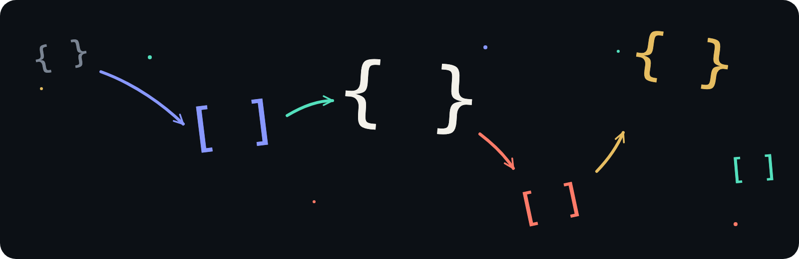

# OBJY DB

<p align="center">
  <strong>Fast in-memory object database for large-scale JavaScript workloads.</strong><br>
  Dynamic objects, low-latency queries, durable distributed storage.
</p>

<p align="center">
  <a href="https://github.com/objy-org/objy/actions/workflows/ci.yml"></a>
  <a href="https://www.npmjs.com/package/@objy/server"></a>
  
  <a href="LICENSE"></a>
  
</p>

OBJY DB keeps dynamic objects and their indexes in memory while local WAL and S3 protect durable state. It scales across shards and replicas without exposing that machinery to application code.

[Server guide](SERVER.md) · [REST API](API.md) · [JavaScript client](https://github.com/objy-org/objy-client) · [Benchmarks](BENCHMARKS.md)

## Server and Client

**`@objy/server` is the database.** It owns memory, storage, queries, authentication, persistence, sharding, and replication.

**`@objy/client` connects applications to it.** It is a small dependency-free HTTP client for browsers and Node.js. It does not contain or start the database.

You can also use the [REST API](API.md) directly.

## Object Model

```text
database
  collection
    object
```

- A **database** is an independent namespace.
- A **collection** holds dynamic objects and a small metadata document.
- An **object** is a schema-free JSON record identified by `_id`.

Objects in one collection may have completely different fields and value types. Collection metadata enables indexes, columns, vectors, hooks, and compressed-memory tiering without changing returned objects.

## Run the Server

The deployment CLI installs and starts `@objy/server` locally:

```sh
npm install --global @objy/cli
objy deploy local --name dev --size tiny
```

It prints the server URL and initial administrator password. Open the URL for the admin console.

```sh
objy status dev
objy logs dev
objy restart dev
objy stop dev
```

For native configuration, persistence, and clusters, see the [server guide](SERVER.md).

## Use the Client

```sh
npm install @objy/client
```

```js
import { createClient } from "@objy/client";

const client = createClient({ url: "http://localhost:8080" });
await client.login({ username: "admin", password: "<printed-password>" });

await client.createDatabase("app");
const app = client.database("app");
await app.createCollection("assets", { indexes: ["status"] });

const assets = app.collection("assets");
```

### Object Operations

The complete object surface stays on one collection handle:

```js
// One object
await assets.insert({ _id: "a1", name: "Laptop", status: "new" });
await assets.get("a1");
await assets.replace("a1", { name: "Laptop Pro", status: "active" });
await assets.patch("a1", { $set: { score: 9 }, $unset: ["status"] });
await assets.remove("a1");

// Read many
await assets.find({ score: { $gte: 5 } }, { limit: 20, sortBy: "score" });
await assets.search({ status: "active" });
await assets.count({ status: "active" });
for await (const asset of assets.iterate({ status: "active" })) console.log(asset);

// Write many
await assets.insertMany([{ _id: "a2" }, { _id: "a3" }]);
await assets.replaceMany([{ _id: "a2", status: "active" }]);
await assets.patchMany([{ _id: "a2", $set: { score: 10 } }]);
await assets.removeMany(["a2", "a3"]);

// Stream insert, replace, patch, or remove sources as NDJSON
await assets.import(source, { operation: "insert" });
```

`replace` is a full-object upsert. `patch` supports Mongo-like `$set` and `$unset`. Aggregation, vectors, references, and files use the same collection context and are covered by the [client guide](https://github.com/objy-org/objy-client) and [REST API](API.md).

## What It Includes

- Dynamic, schema-free objects with complete-object reads.
- Queries, aggregation, field indexes, RID columns, vectors, and live references.
- Single, bulk, and streamed NDJSON writes through one storage model.
- Authentication, permissions, hooks, and an administration console.
- Local WAL acknowledgements, S3 snapshots and journals, sharding, and replication.

See [BENCHMARKS.md](BENCHMARKS.md) for reproducible performance results.

## License

Original source code is available under the [MIT License](LICENSE). OBJY and OBJY DB names, logos, brand artwork, and product copy remain reserved as described in [NOTICE.md](NOTICE.md). Third-party materials retain their respective licenses.
