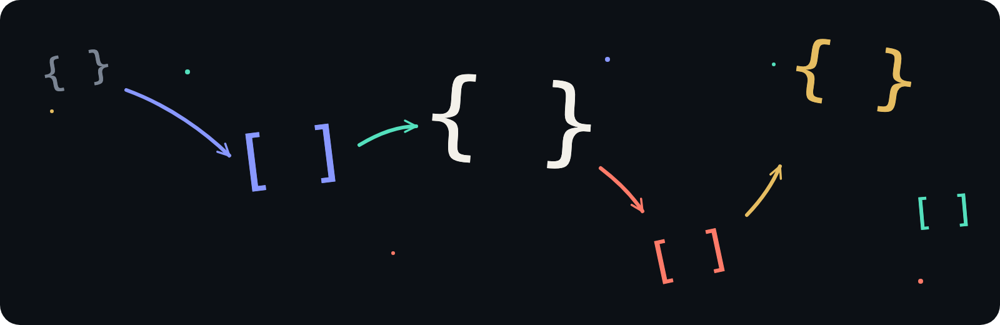

# OBJY DB

<p align="center"><strong>Fast in-memory object database for large-scale JavaScript workloads.</strong></p>

<p align="center">
  <a href="https://github.com/objy-org/objy/actions/workflows/ci.yml"></a>
  <a href="https://www.npmjs.com/package/@objy/db"></a>
  
  <a href="https://github.com/objy-org/objy/blob/main/LICENSE"></a>
  
</p>

Keep dynamic JSON objects in memory. Query, aggregate, and follow live references. Use indexes, compact columns, and compressed memory to fit more data. Scale across shards and replicas, with local WAL and S3 durability when configured.

```text
database -> collection -> objects
```

Objects need no shared schema. Each has an `_id`; collections have metadata for indexes, storage, and conditional read defaults. Applications connect through REST or the small JavaScript client.

## Start the Database

The deployment CLI (Node.js 22+) downloads and starts OBJY DB locally:

```sh
npm install --global @objy/cli
objy deploy local --name dev --size tiny
```

Open the printed URL for the Data Explorer and sign in with the initial administrator password printed in the logs.

```sh
objy status dev
objy logs dev --follow
objy stop dev
objy start dev
```

Prefer to run it yourself? See [Run the Server](https://github.com/objy-org/objy/blob/main/DB.md#run-the-server) for direct Node.js startup and configuration.

## Work with Objects

```sh
npm install @objy/client
```

```js
import { createClient } from "@objy/client";

const client = createClient({ url: "http://127.0.0.1:8080" });
await client.login({ username: "admin", password: "<printed-password>" });

await client.createDatabase("app");
const app = client.database("app");
await app.createCollection("assets", { indexes: ["status"] });
const assets = app.collection("assets");

await assets.insert({ _id: "a1", name: "Laptop", status: "new" });
await assets.get("a1");
await assets.find({ status: "new" });
await assets.replace("a1", { name: "Laptop Pro", status: "active" });
await assets.patch("a1", { $set: { score: 9 }, $unset: ["status"] });
await assets.remove("a1");
```

The same collection handle supports bulk and streamed writes, aggregation, vector search, references, and files. `@objy/db` runs the database; `@objy/client` connects to it; `@objy/cli` manages deployments.

## Go Deeper

- [Database guide](https://github.com/objy-org/objy/blob/main/DB.md): objects, queries, collection meta, configuration, persistence, and clusters.
- [JavaScript client](https://github.com/objy-org/objy-client): application API and client options.
- [REST API](https://github.com/objy-org/objy/blob/main/API.md): public endpoints with requests and responses.
- [Benchmarks](https://github.com/objy-org/objy/blob/main/BENCHMARKS.md): reproducible measurements and their limits.
- [Contributing](https://github.com/objy-org/objy/blob/main/CONTRIBUTING.md): source setup, development, and verification.

## License

Original source code is available under the [MIT License](https://github.com/objy-org/objy/blob/main/LICENSE). OBJY and OBJY DB names, logos, brand artwork, and product copy remain reserved as described in [NOTICE.md](https://github.com/objy-org/objy/blob/main/NOTICE.md). Third-party materials retain their respective licenses.
