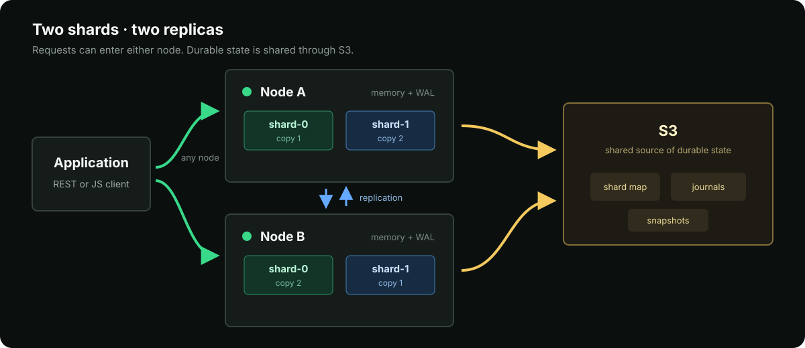

# OBJY DB

<p align="center">
  <strong>Fast in-memory object database for large-scale JavaScript workloads.</strong><br>
  Dynamic objects, low-latency queries, durable distributed storage.
</p>

<p align="center">
  <a href="https://github.com/objy-org/objy/actions/workflows/ci.yml"></a>
  <a href="https://www.npmjs.com/package/@objy/server"></a>
  
  <a href="LICENSE"></a>
  
</p>

OBJY DB keeps dynamic objects and their indexes in memory while local WAL and S3 protect durable state. It scales across shards and replicas without exposing that machinery to application code.

[REST API](API.md) · [JavaScript client](https://github.com/objy-org/objy-client) · [Benchmarks](BENCHMARKS.md)

## Server and Client

**`@objy/server` is the database.** It owns memory, storage, queries, authentication, persistence, sharding, replication, and the administration console.

**`@objy/client` connects applications to it.** It is a small dependency-free HTTP client for browsers and Node.js. It does not contain or start the database.

You can also use the [REST API](API.md) directly.

## Object Model

```text
database
  collection
    object
```

- A **database** is an independent namespace.
- A **collection** holds dynamic objects and one small metadata document.
- An **object** is a schema-free JSON record identified by `_id`.

Objects in one collection may have completely different fields and value types. Metadata optimizes how a collection is stored and queried without imposing a schema.

## Object Anatomy

An object starts as ordinary JSON:

```json
{
  "_id": "post-1",
  "title": "Hello",
  "status": "published",
  "author": {
    "type": "reference",
    "collection": "users",
    "value": "user-1"
  },
  "_vec": [0.12, 0.48, 0.91]
}
```

- `_id` is unique inside its collection. OBJY DB generates a compact id when it is omitted.
- References point to objects in another collection or database. They stay live rather than storing an embedded copy and can be expanded or queried through `.object` paths.
- `_vec` supplies a custom embedding for vector search. Vector data is indexed separately and hidden from ordinary reads.
- `_file` can connect an object to a private S3 blob, so metadata, permissions, and file content share one object lifecycle.

Reads still return complete, ordinary objects. Indexes, columns, references, compression, vectors, and files remain storage and query capabilities rather than a second object format.

## Collection Meta

Every collection has a small metadata object that configures its derived behavior:

```json
{
  "indexes": ["status", "tenantId"],
  "columns": ["score"],
  "tiering": {
    "mode": "compressedMemory",
    "keep": ["name", "status", "tenantId"],
    "minBytes": 4096
  },
  "hooks": {
    "enabled": true,
    "use": ["timestamps", "audit"]
  }
}
```

| Field | Purpose |
| --- | --- |
| `indexes` | Field indexes narrow filters, support indexed grouping, and accelerate sorting. |
| `columns` | RID-addressed typed values accelerate numeric aggregation and reduce duplicate object storage. |
| `tiering` | Keeps selected fields hot and compresses the remaining object data in memory. Use either `keep` or `offload`. |
| `hooks` | Enables server-registered create, read, update, and delete hooks for the collection. |

Changing meta rebuilds the affected in-memory structures cooperatively. Full objects remain the persistence format and the API result shape.

## Run the Server

The deployment CLI installs and starts `@objy/server` locally:

```sh
npm install --global @objy/cli
objy deploy local --name dev --size tiny
```

It prints the server URL and initial administrator password. Open the URL for the admin console.

```sh
objy status dev
objy logs dev --follow
objy restart dev
objy stop dev
```

<details>
<summary><strong>Start from another Node.js process</strong></summary>

```sh
npm install @objy/server
```

```js
import { startServer } from "@objy/server";

const runtime = await startServer({ port: 8080 });
console.log(`OBJY DB listening on http://127.0.0.1:${runtime.port}`);
```

</details>

## Architecture



Requests may enter either node. Each shard has two in-memory replicas, nodes replicate asynchronously, and S3 holds the shared shard map, journals, and snapshots. The local WAL protects acknowledged writes before asynchronous persistence catches up.

## Configuration

OBJY DB reads `objydb.config.json`. This example shows a durable S3-backed node:

```json
{
  "node": {
    "id": "node-a",
    "url": "http://node-a:8080",
    "retainOps": 256,
    "syncBatchSize": 50000
  },
  "server": {
    "port": 8080,
    "cors": false
  },
  "storage": {
    "engine": "object"
  },
  "files": {
    "mode": "s3",
    "prefix": "objydb/files"
  },
  "memoryGuard": {
    "enabled": true,
    "rejectWritesPercent": 85,
    "resumeWritesPercent": 78
  },
  "cluster": {
    "syncMs": 2500,
    "forwardTimeoutMs": 60000,
    "replicationTimeoutMs": 60000,
    "shardMapStore": {
      "mode": "s3",
      "prefix": "objydb",
      "key": "cluster/shard-map.json"
    }
  },
  "auth": {
    "accessTokenTtlSeconds": 3600,
    "refreshTokenTtlSeconds": 1209600
  },
  "persistence": {
    "mode": "s3",
    "prefix": "objydb",
    "ack": "localWal",
    "flushMs": 5000,
    "snapshotMs": 60000,
    "compactJournals": true,
    "snapshotRetention": { "keepLatest": 5 },
    "localWal": {
      "mode": "on",
      "dir": "/var/lib/objydb/wal",
      "fsync": true
    },
    "s3": {
      "bucket": "objydb",
      "endpoint": "https://s3.example.com",
      "region": "us-east-1",
      "accessKeyId": { "fromEnvironment": "OBJYDB_S3_ACCESS_KEY_ID" },
      "secretAccessKey": { "fromEnvironment": "OBJYDB_S3_SECRET_ACCESS_KEY" }
    }
  }
}
```

| Section | Purpose |
| --- | --- |
| `node` | Local identity, public URL, retained replication operations, and pull batch size. Every peer needs a unique `id` and `url`. |
| `server` | HTTP port, CORS, and request limits. |
| `storage` | In-memory engine. `object` is the default. |
| `files` | Optional object-backed file storage. S3 settings inherit from `persistence.s3`. |
| `memoryGuard` | Pauses writes under memory pressure and resumes them after usage falls below the lower threshold. |
| `cluster` | Replication timing, forwarding timeouts, hints, and shard-map storage. A map may be inline or shared through S3. |
| `auth` | Access- and refresh-token lifetimes. System secrets and the first admin password are generated when omitted. |
| `persistence` | Durability mode, namespace, WAL acknowledgement, journal flushes, snapshots, retention, and S3 access. |
| `imports`, `plugins`, `vector` | Optional limits, server plugins, and vector-index settings. |

Nodes in one cluster share the S3 bucket and prefix. Give each node a unique identity and keep its WAL on durable local storage. Use `mode: "off"` for persistence and shard-map storage when running a temporary memory-only server.

## Use the Client

```sh
npm install @objy/client
```

```js
import { createClient } from "@objy/client";

const client = createClient({ url: "http://localhost:8080" });
await client.login({ username: "admin", password: "<printed-password>" });

await client.createDatabase("app");
const app = client.database("app");
await app.createCollection("assets", { indexes: ["status"] });

const assets = app.collection("assets");
```

### Object Operations

The complete object surface stays on one collection handle:

```js
// One object
await assets.insert({ _id: "a1", name: "Laptop", status: "new" });
await assets.get("a1");
await assets.replace("a1", { name: "Laptop Pro", status: "active" });
await assets.patch("a1", { $set: { score: 9 }, $unset: ["status"] });
await assets.remove("a1");

// Read many
await assets.find({ score: { $gte: 5 } }, { limit: 20, sortBy: "score" });
await assets.search({ status: "active" });
await assets.count({ status: "active" });
for await (const asset of assets.iterate({ status: "active" })) console.log(asset);

// Write many
await assets.insertMany([{ _id: "a2" }, { _id: "a3" }]);
await assets.replaceMany([{ _id: "a2", status: "active" }]);
await assets.patchMany([{ _id: "a2", $set: { score: 10 } }]);
await assets.removeMany(["a2", "a3"]);

// Stream insert, replace, patch, or remove sources as NDJSON
await assets.import(source, { operation: "insert" });
```

`replace` is a full-object upsert. `patch` supports Mongo-like `$set` and `$unset`. Aggregation, vectors, references, and files use the same collection context and are covered by the [client guide](https://github.com/objy-org/objy-client) and [REST API](API.md).

See [BENCHMARKS.md](BENCHMARKS.md) for reproducible performance results.

## License

Original source code is available under the [MIT License](LICENSE). OBJY and OBJY DB names, logos, brand artwork, and product copy remain reserved as described in [NOTICE.md](NOTICE.md). Third-party materials retain their respective licenses.
