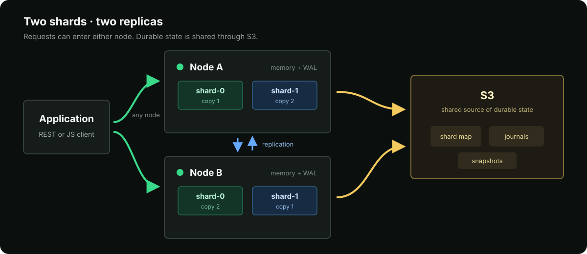

# OBJY DB Server

**Run the in-memory object database as a shared, durable, distributed service.**

`@objy/server` contains the database engine, HTTP interface, authentication, persistence, clustering, and administration console.

[Overview](README.md) · [REST API](API.md) · [JavaScript client](https://github.com/objy-org/objy-client)

## Run the Server

The deployment CLI installs and starts a local server:

```sh
npm install --global @objy/cli
objy deploy local --name dev --size tiny
```

It prints the server URL and initial administrator password.

```sh
objy status dev
objy logs dev --follow
objy restart dev
objy stop dev
```

<details>
<summary><strong>Start from another Node.js process</strong></summary>

```sh
npm install @objy/server
```

```js
import { startServer } from "@objy/server";

const runtime = await startServer({ port: 8080 });
console.log(`OBJY DB listening on http://127.0.0.1:${runtime.port}`);
```

</details>

## Architecture



Requests may enter either node. Each shard has two in-memory replicas, nodes replicate asynchronously, and S3 holds the shared shard map, journals, and snapshots. The local WAL protects acknowledged writes before asynchronous persistence catches up.

## Configuration

OBJY DB reads `objydb.config.json`. This example shows a durable S3-backed node:

```json
{
  "node": {
    "id": "node-a",
    "url": "http://node-a:8080",
    "retainOps": 256,
    "syncBatchSize": 50000
  },
  "server": {
    "port": 8080,
    "cors": false
  },
  "storage": {
    "engine": "object"
  },
  "files": {
    "mode": "s3",
    "prefix": "objydb/files"
  },
  "memoryGuard": {
    "enabled": true,
    "rejectWritesPercent": 85,
    "resumeWritesPercent": 78
  },
  "cluster": {
    "syncMs": 2500,
    "forwardTimeoutMs": 60000,
    "replicationTimeoutMs": 60000,
    "shardMapStore": {
      "mode": "s3",
      "prefix": "objydb",
      "key": "cluster/shard-map.json"
    }
  },
  "auth": {
    "accessTokenTtlSeconds": 3600,
    "refreshTokenTtlSeconds": 1209600
  },
  "persistence": {
    "mode": "s3",
    "prefix": "objydb",
    "ack": "localWal",
    "flushMs": 5000,
    "snapshotMs": 60000,
    "compactJournals": true,
    "snapshotRetention": { "keepLatest": 5 },
    "localWal": {
      "mode": "on",
      "dir": "/var/lib/objydb/wal",
      "fsync": true
    },
    "s3": {
      "bucket": "objydb",
      "endpoint": "https://s3.example.com",
      "region": "us-east-1",
      "accessKeyId": { "fromEnvironment": "OBJYDB_S3_ACCESS_KEY_ID" },
      "secretAccessKey": { "fromEnvironment": "OBJYDB_S3_SECRET_ACCESS_KEY" }
    }
  }
}
```

| Section | Purpose |
| --- | --- |
| `node` | Local identity, public URL, retained replication operations, and pull batch size. Every peer needs a unique `id` and `url`. |
| `server` | HTTP port, CORS, and request limits. |
| `storage` | In-memory engine. `object` is the default. |
| `files` | Optional object-backed file storage. S3 settings inherit from `persistence.s3`. |
| `memoryGuard` | Pauses writes under memory pressure and resumes them after usage falls below the lower threshold. |
| `cluster` | Replication timing, forwarding timeouts, hints, and shard-map storage. A map may be inline or shared through S3. |
| `auth` | Access- and refresh-token lifetimes. System secrets and the first admin password are generated when omitted. |
| `persistence` | Durability mode, namespace, WAL acknowledgement, journal flushes, snapshots, retention, and S3 access. |
| `imports`, `plugins`, `vector` | Optional limits, server plugins, and vector-index settings. |

Nodes in one cluster share the S3 bucket and prefix. Give each node a unique identity and keep its WAL on durable local storage. Use `mode: "off"` for persistence and shard-map storage when running a temporary memory-only server.
